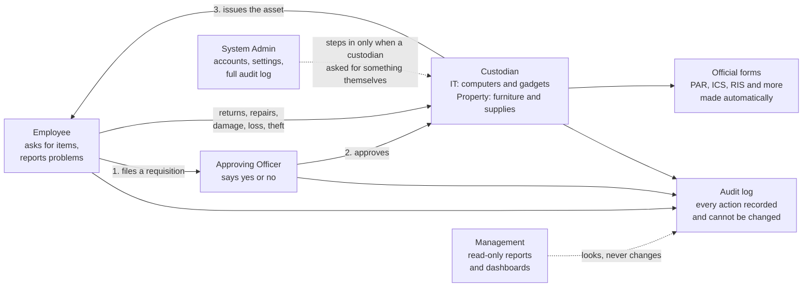
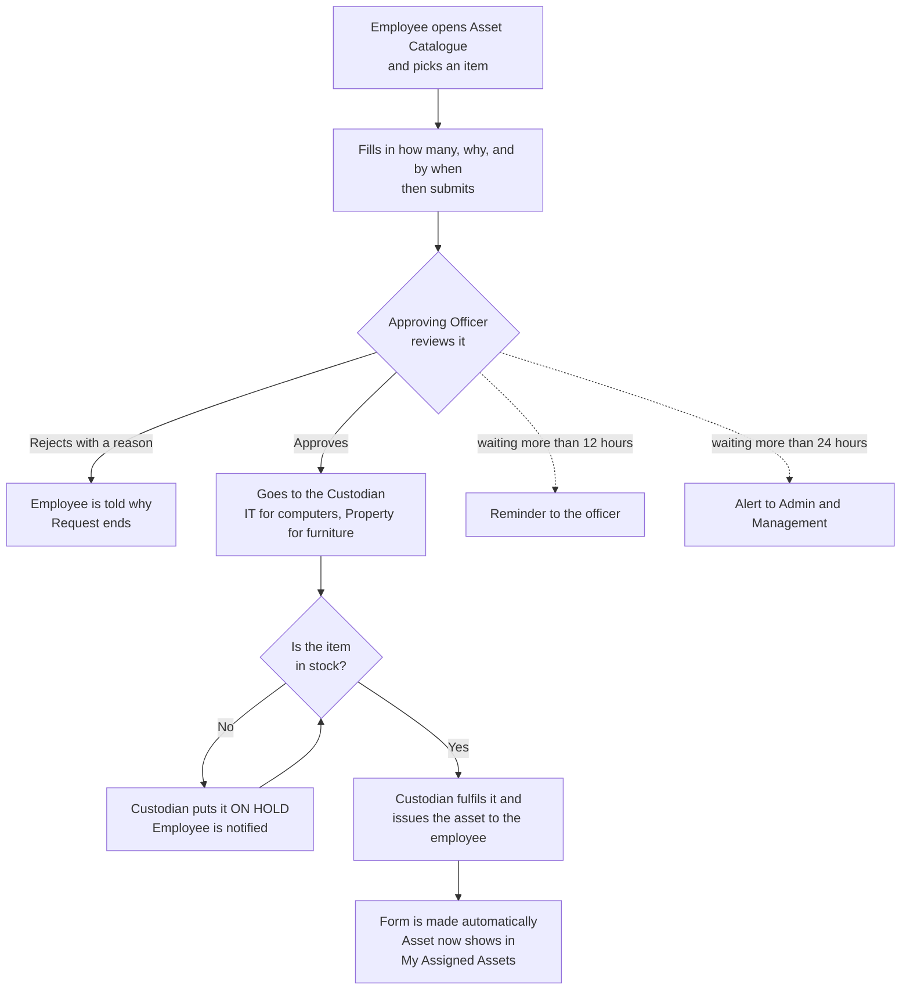
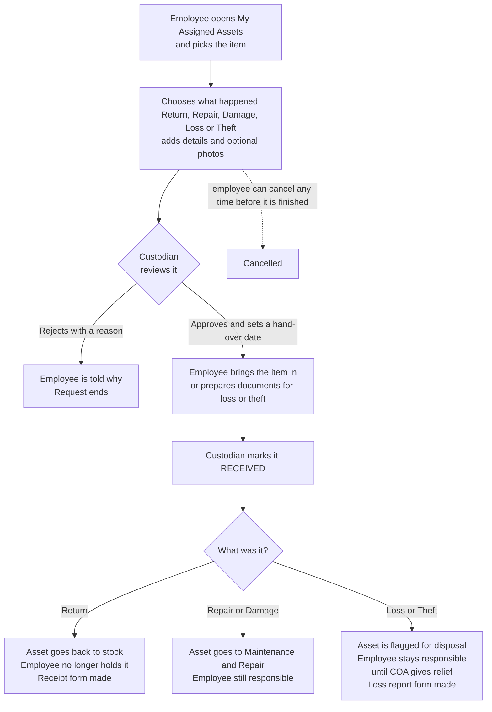
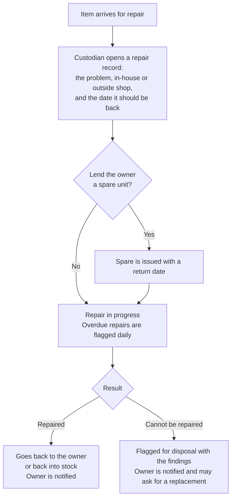
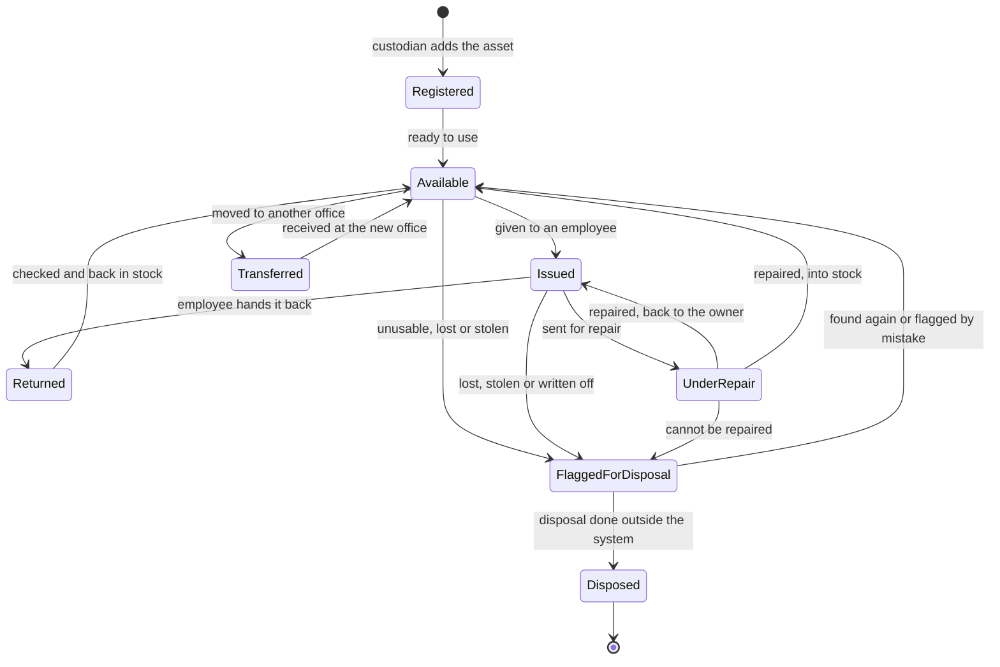
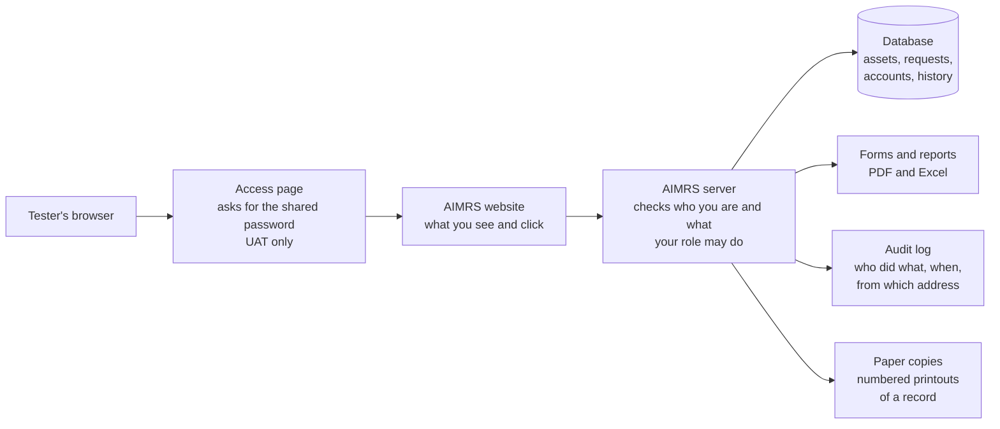
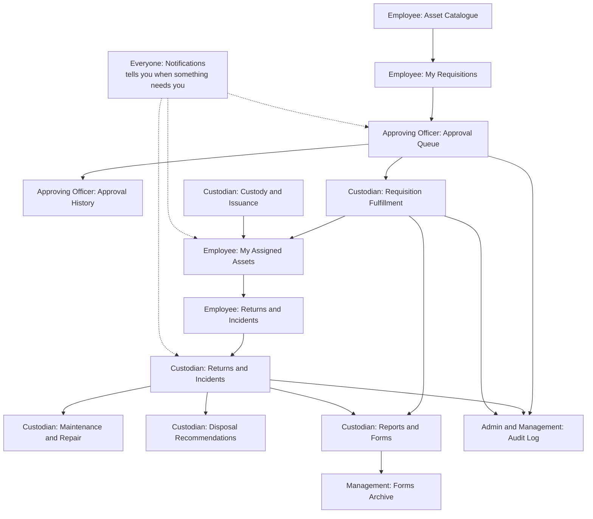
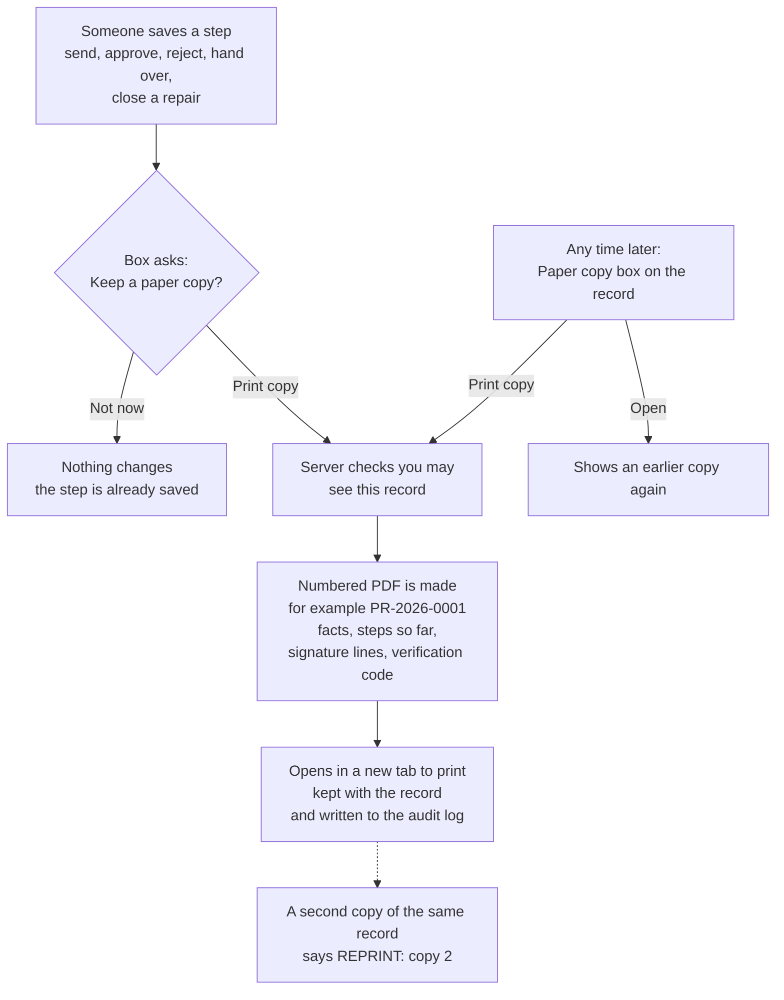

# AIMRS: how the system flows (diagrams)

Plain pictures of how things move through AIMRS. To see them: GitHub shows each diagram automatically, or copy the
text between the ```mermaid lines into **https://mermaid.live** and it draws it (you can then download it as an image or PDF).

---

## 1. The big picture: who does what



---

## 2. Asking for an item (requisition)



A custodian never approves or fulfils a request they filed themselves. Those go to the **System Admin** instead.

---

## 3. Returns and incidents (return, repair, damage, loss, theft)



---

## 4. Maintenance and repair



---

## 5. Life of an asset



"Disposed" is the end: AIMRS only records and flags disposal. The real disposal is done by CICC through the COA process.

---

## 6. What happens behind the screen



---

## 7. Which screens connect to which



---

## 8. A paper copy after a step

CICC asked for a printed proof after every step on a requisition, a return or incident report, and a repair. Printing is always optional and never holds up the step.



A paper copy is not an official COA form, so it is kept on its record and is not listed in the Forms Archive.
